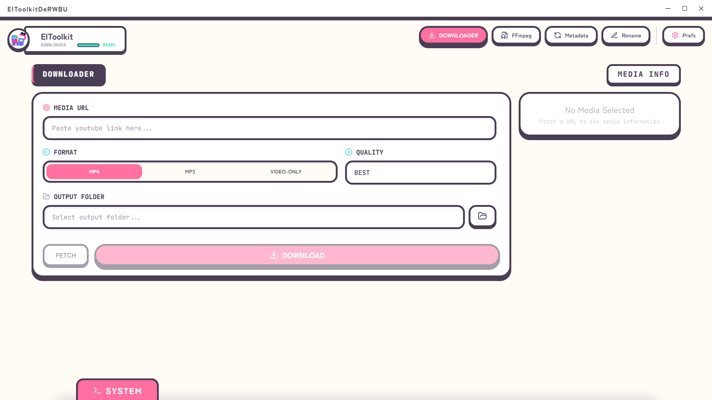

<div align="center">

# ElToolkitDeRWBU

**Download, convert, tag, rename, and analyze BPM. One window, zero terminal.**

A cross-platform desktop toolkit that puts FFmpeg, yt-dlp, and a studio-minded BPM tool behind a clean, game-flavored interface. Everything it needs is bundled.



</div>

## Why this exists

I kept reaching for the same command-line tools to download a video, trim a clip, fix a batch of MP3 tags, or rename a messy folder, and retyping the same flags every time. ElToolkitDeRWBU is my answer: the tools I actually use, wrapped in an interface that is quick to use and fun to look at. It started as a personal script collection and grew into a proper app, built from scratch and developed iteratively with AI assistance.

## Features

- **Media Downloader (yt-dlp):**
  - Download MP4 video, MP3 audio, or video-only streams.
  - Quality selection ranging from 360p up to 4K with adaptive quality fallback.
  - Configurable audio bitrates (192k, 256k, 320k).
  - Pre-download inspection modal for multi-URL batches and full playlists.
  - Parallel downloads (1–10 concurrent jobs managed via `p-limit`) and download rate throttling (e.g. `5M` or `500K`).
  - Authentication support via direct browser cookie extraction (Chrome, Firefox, Edge, Brave, Safari, Opera) or Netscape `cookies.txt` files.
  - Safe queue management: cancel individual or all tasks, retry failed downloads, and trigger in-app `yt-dlp -U` updates reporting to the live System Log.

- **FFmpeg Tools:**
  - **Audio Extraction:** Batch convert media files to MP3 using `libmp3lame` at user-selected bitrates.
  - **Trimming:** Losslessly trim media files by exact start and end timestamps (`hh:mm:ss`) using stream copy (`-c copy`) without re-encoding.
  - **Mirroring:** Batch horizontal flipping (`-vf hflip`) with H.264 video compression, AAC audio, and real-time progress tracking probed via `ffprobe`.

- **BPM Modifier:**
  - **Tempo Detection:** Uses `librosa` harmonic-percussive source separation (HPSS), onset envelopes, and beat tracking.
  - **Octave & Ambiguity Handling:** Constrain analysis to expected BPM ranges (`70–150`, `90–180`, `120–200`, or `any`) with confidence ratings (`high`, `medium`, `low`) and octave candidate suggestions (0.5x, 1x, 2x).
  - **Manual Correction:** Interactive inline BPM correction input (with `0.01` precision) to fix slight drift or octave mismatches prior to processing.
  - **Pitch-Preserving Tempo Modification:** Applies time-stretching (`librosa.effects.time_stretch`) to match any unified target tempo between 20 and 300 BPM.
  - **Export Options:** Output directly to lossless WAV or convert to compressed MP3 via FFmpeg (`-q:a 2`).

- **Batch Metadata Editor:**
  - Write standard ID3 tags (Title, Artist, Album, Year) to MP3 files.
  - Supports single-file or recursive batch folder tagging with live progress tracking.

- **Batch File Renamer:**
  - Modes for Find and Replace (with case-sensitivity toggle), Prefixes & Suffixes, and Sequential Numbering (custom base name, start index, and zero padding like `Track_001`).
  - Real-time preview with collision and conflict detection before renaming files on disk.
  - One-click undo to restore previous filenames.

- **Quality of Life:**
  - Catppuccin-inspired Light and Midnight Dark themes.
  - Custom game-styled frameless window and titlebar.
  - Optional minimize-to-system-tray behavior with native desktop notifications.
  - Live System Terminal Log view for troubleshooting background operations.
  - Graceful cancellation for every running child process.

See [CHANGELOG.md](CHANGELOG.md) for the complete version history.

## Download

Grab the latest prebuilt release for your operating system from the [Releases page](https://github.com/rwbu69/eltoolkitde_rwbu/releases/latest). All dependencies (FFmpeg, FFprobe, yt-dlp, Node.js, and BPM tools) are bundled with the installer.

| Platform | Format | Recommended Release File |
| :--- | :--- | :--- |
| **Windows (64-bit)** | NSIS Installer | `ElToolkitDeRWBU_*_x64-setup.exe` |
| **Linux (64-bit)** | AppImage | `ElToolkitDeRWBU_*_amd64.AppImage` |
| **Linux (Debian / Ubuntu 64-bit)** | Debian Package | `ElToolkitDeRWBU_*_amd64.deb` |
| **macOS (Apple Silicon)** | Disk Image | `ElToolkitDeRWBU_*_aarch64.dmg` |
| **macOS (Intel)** | Disk Image | `ElToolkitDeRWBU_*_x64.dmg` |

> [!IMPORTANT]
> macOS builds are native and architecture-specific. Be sure to download the build matching your Mac (`aarch64` for Apple Silicon M1/M2/M3/M4, `x64` for Intel).

### Running Unsigned Builds on macOS

Because macOS releases are distributed without Apple Developer notarization, macOS Gatekeeper will block first launch by default. To run the app:

1. Download the matching `.dmg`, open it, and drag `ElToolkitDeRWBU` to your `Applications` folder.
2. In Finder, **Right-click (or Control-click)** the app icon and select **Open**.
3. In the warning dialog that appears, click **Open**.

If macOS still does not present the Open option:
1. Open **System Settings** → **Privacy & Security**.
2. Scroll down to find the security message stating *ElToolkitDeRWBU was blocked from use*.
3. Click **Open Anyway**.

If Gatekeeper persistently refuses to launch the application or its bundled sidecars, open Terminal and remove the quarantine attribute:

```bash
xattr -dr com.apple.quarantine "/Applications/ElToolkitDeRWBU.app"
open "/Applications/ElToolkitDeRWBU.app"
```

### Running on Linux

#### AppImage
```bash
chmod +x ElToolkitDeRWBU*.AppImage
./ElToolkitDeRWBU*.AppImage
```

#### Debian / Ubuntu
```bash
sudo apt install ./ElToolkitDeRWBU*.deb
```

*Note*: Packages are built on Ubuntu 22.04 with standard GNU libc. On minimal distributions, ensure common desktop libraries such as WebKitGTK (`libwebkit2gtk-4.1-dev` / `libgtk-3-0`) and `libsndfile1` are installed.

### Known Packaging Boundaries
- Supported targets are 64-bit Windows, 64-bit Linux (glibc), macOS Intel x64, and macOS Apple Silicon ARM64.
- ARM Linux and universal macOS fat binaries are not currently targeted because all bundled binary sidecars require native compilation for each target architecture.

## Build from Source

### Prerequisites
- [Node.js](https://nodejs.org) (v24 recommended) and `npm`
- [Rust](https://rustup.rs) (stable) and [Tauri v2 system prerequisites](https://v2.tauri.app/start/prerequisites/) for your OS
- [Python 3.11+](https://www.python.org) (only needed if compiling the BPM sidecars locally)

### 1. Clone and Install Dependencies
```bash
git clone https://github.com/rwbu69/eltoolkitde_rwbu.git
cd eltoolkitde_rwbu
npm ci
```

### 2. Sidecar Preparation
- **FFmpeg, FFprobe, Node.js, and yt-dlp**: Handled **automatically**. Tauri hooks (`beforeDevCommand` and `beforeBuildCommand` in `tauri.conf.json`) run `scripts/setup-sidecars.cjs`, which downloads host-compatible binaries into `src-tauri/`.
- **Python BPM Sidecars (`bpm_detector` & `bpm_modifier`)**: For local development, compile the standalone Python executables once using PyInstaller:
  ```bash
  pip install pyinstaller librosa soundfile
  pyinstaller --onefile --distpath src-tauri --name bpm_detector-<TARGET> src-python/bpm_detector.py
  pyinstaller --onefile --distpath src-tauri --name bpm_modifier-<TARGET> src-python/bpm_modifier.py
  ```
  *(Replace `<TARGET>` with your target triple, e.g. `x86_64-pc-windows-msvc`, `x86_64-unknown-linux-gnu`, `x86_64-apple-darwin`, or `aarch64-apple-darwin`).*

### 3. Run and Build Commands
- **Run desktop app (development)**:
  ```bash
  npm run dev
  ```
- **Build desktop installer (production)**:
  ```bash
  npm run build
  ```
- **Run frontend only in browser**:
  ```bash
  npm run vite:dev
  ```
- **Run test suite**:
  ```bash
  npm test
  ```
- **Lint frontend code**:
  ```bash
  npm run lint
  ```

## Tech Stack

- **Desktop Framework:** [Tauri v2](https://tauri.app) (Rust shell, OS integrations, native windowing, sidecar process isolation)
- **Frontend UI:** [React 19](https://react.dev), [TypeScript](https://www.typescriptlang.org), [Vite 8](https://vitejs.dev)
- **State Management:** [Zustand](https://github.com/pmndrs/zustand) with persistent settings storage
- **Styling:** [Tailwind CSS](https://tailwindcss.com) with Catppuccin color tokens
- **Audio Processing:** Python 3.11, [librosa](https://librosa.org), and [soundfile](https://github.com/bastibe/python-soundfile)
- **Bundled Engines:** [FFmpeg](https://ffmpeg.org), [FFprobe](https://ffmpeg.org), [yt-dlp](https://github.com/yt-dlp/yt-dlp), [Node.js](https://nodejs.org)
- **Testing & Quality:** [Vitest](https://vitest.dev) and [oxlint](https://oxc.rs)
- **Continuous Integration:** Native GitHub Actions matrix runners (`windows-latest`, `ubuntu-22.04`, `macos-14`, `macos-15-intel`)

## Acknowledgements

This project is built on the shoulders of outstanding open-source projects:
- [FFmpeg](https://ffmpeg.org) and [yt-dlp](https://github.com/yt-dlp/yt-dlp) for media processing and download engines.
- [Tauri](https://tauri.app) for the lightweight desktop framework.
- [librosa](https://librosa.org) and the Python audio community.
- [Catppuccin](https://github.com/catppuccin/catppuccin) for the color palette foundations.
- Visual novel and game HUD designs for layout and interface styling inspirations.
- Built iteratively with AI assistance.

## Third-Party Software

Release packages bundle FFmpeg, FFprobe, yt-dlp, Node.js runtime binaries, and Python audio libraries, each distributed under its respective open-source license. The bundled static FFmpeg and FFprobe builds are licensed under the **GNU General Public License v3.0 or later (GPL-3.0-or-later)**.

For full license texts, upstream links, and instructions on obtaining source code for bundled software, please review [THIRD_PARTY_NOTICES.md](THIRD_PARTY_NOTICES.md).

## Disclaimer

Only download and convert media content you have the legal right or permission to process. Respect the intellectual property rights and terms of service of any third-party websites or platforms you access with this tool.

## License

ElToolkitDeRWBU source code is released under the **MIT License**. Copyright (c) 2026 RWBU. See [LICENSE](LICENSE) for details.
