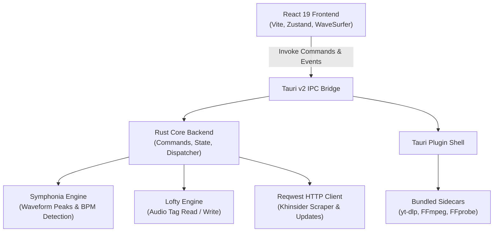

<div align="center">


# ElToolkitDeRWBU

**A friendly desktop workstation for downloading media, inspecting audio waveforms, analyzing BPM, editing tags, and organizing files.**

[](https://github.com/rwbu69/eltoolkitde_rwbu/releases/latest)
[](https://github.com/rwbu69/eltoolkitde_rwbu/releases)
[](LICENSE)
[](https://github.com/rwbu69/eltoolkitde_rwbu/releases/latest)
[](https://github.com/rwbu69/eltoolkitde_rwbu/actions/workflows/ci.yml)
[](https://tauri.app)
[](https://react.dev)
[](https://www.rust-lang.org)

[Download](#download) • [Features at a Glance](#features-at-a-glance) • [Detailed Features](#detailed-features) • [Architecture](#architecture) • [Build from Source](#build-from-source) • [Contributing](#project-status-and-contributing)

<br/>


</div>

## Why this exists

I kept finding myself opening three separate terminal windows just to download a video, trim an audio snippet, fix broken metadata tags, or rename an entire folder with sequential padding. Retyping the same command-line flags and arguments over and over gets old fast.

ElToolkitDeRWBU is my personal answer: an approachable, game-HUD-inspired desktop workstation bringing together the media tools I rely on every day, without the command-line fatigue.

This project stands on the shoulders of open-source giants. It would not exist without the dedication of the communities behind [FFmpeg](https://ffmpeg.org), [yt-dlp](https://github.com/yt-dlp/yt-dlp), [Tauri](https://tauri.app), [Symphonia](https://github.com/pdeljanov/Symphonia), [Lofty](https://github.com/Serial-ATA/lofty-rs), and [React](https://react.dev). I am deeply grateful to all of their maintainers.

## Download

Precompiled releases are available on the [GitHub Releases page](https://github.com/rwbu69/eltoolkitde_rwbu/releases/latest). All external binary sidecars (FFmpeg, FFprobe, and yt-dlp) are bundled directly inside the application installer.

| Platform | Architecture / Target | Package Type | Release File Pattern |
| :--- | :--- | :--- | :--- |
| **Windows** | 64-bit (x86_64) | NSIS Installer | `ElToolkitDeRWBU_*_x64-setup.exe` |
| **Linux** | 64-bit (x86_64) | Standalone AppImage | `ElToolkitDeRWBU_*_amd64.AppImage` |
| **Linux** | Debian / Ubuntu (x86_64) | Debian Package | `ElToolkitDeRWBU_*_amd64.deb` |
| **macOS** | Apple Silicon (M1/M2/M3/M4) | DMG Disk Image | `ElToolkitDeRWBU_*_aarch64.dmg` |
| **macOS** | Intel (x86_64) | DMG Disk Image | `ElToolkitDeRWBU_*_x64.dmg` |

> [!IMPORTANT]
> macOS builds are architecture-specific. Please download the `.dmg` matching your Mac hardware: `aarch64` for Apple Silicon (M1 or newer) or `x64` for Intel Macs.

<details>
<summary>Running unsigned builds on macOS</summary>

Because releases are currently distributed without Apple Developer notarization, macOS Gatekeeper blocks the first launch by default. To run the app:

1. Download the matching `.dmg`, double-click to open it, and drag `ElToolkitDeRWBU` into your `Applications` folder.
2. In Finder, **Right-click (or Control-click)** `ElToolkitDeRWBU` and select **Open**.
3. In the warning prompt that appears, click **Open**.

If macOS does not show the Open button:

1. Open **System Settings** → **Privacy & Security**.
2. Scroll to the Security section where it mentions *ElToolkitDeRWBU was blocked from use*.
3. Click **Open Anyway**.

If Gatekeeper continues to block the application or its bundled binary sidecars, open Terminal and clear the quarantine attribute:

```bash
xattr -dr com.apple.quarantine "/Applications/ElToolkitDeRWBU.app"
open "/Applications/ElToolkitDeRWBU.app"
```

</details>

<details>
<summary>Running on Linux</summary>

#### AppImage

Make the downloaded AppImage executable and launch it:

```bash
chmod +x ElToolkitDeRWBU*.AppImage
./ElToolkitDeRWBU*.AppImage
```

#### Debian / Ubuntu Package

Install via `apt`:

```bash
sudo apt install ./ElToolkitDeRWBU*.deb
```

*Note*: Packages are compiled on Ubuntu 22.04 with standard GNU libc. On minimal installations, ensure desktop dependencies such as WebKitGTK (`libwebkit2gtk-4.1-dev` and `libgtk-3-0`) are installed.
</details>

## Features at a Glance

| Tool | Core Capability | Under the Hood |
| :--- | :--- | :--- |
| **Media Downloader** | Download MP4, MP3, and video streams with direct cover art embedding and batch queue management | yt-dlp + FFmpeg |
| **Game Music Browser** | Search, explore, and batch download game soundtracks with album cover art | Reqwest + Scraper (Khinsider) |
| **Audio Studio** | Interactive audio waveform inspection, playback looping, millisecond nudge trimming, and lossless cutting | wavesurfer.js + Symphonia + FFmpeg |
| **FFmpeg Processor** | Batch MP3 extraction, lossless timestamp trimming, and horizontal video mirroring | Bundled FFmpeg + FFprobe |
| **BPM Analyzer** | Native Rust tempo detection, confidence scoring, octave filtering, and pitch-preserving tempo modification | Symphonia + FFmpeg |
| **Metadata Editor** | Batch inspect and edit audio tags (Title, Artist, Album, Year, Genre, Track Number) | Lofty Rust Engine |
| **Batch File Renamer** | Find and replace, prefix/suffix insertion, and sequential padding with conflict detection | Native Rust Filesystem Commands |
| **Workstation HUD** | Catppuccin Mocha & Latte themes, system tray minimization, live terminal log drawer, single-instance lock | Tauri v2 + Zustand + Tailwind CSS |

## Detailed Features

<details>
<summary>Media Downloader (yt-dlp)</summary>

- **Format Flexibility:** Download MP4 video, MP3 audio, or standalone video streams.
- **Embed-Only Thumbnail Pipeline:** Cover art is embedded directly into MP4 and MP3 files (`--embed-thumbnail`, `--convert-thumbnails jpg`, `-disposition:v:1 attached_pic`), leaving zero standalone `.jpg` or `.webp` files in your output folders.
- **Quality & Resolution Selection:** Choose resolutions from 360p up to 4K with adaptive format fallback.
- **Audio Bitrate Control:** Configurable MP3 encoding presets at 192 kbps, 256 kbps, and 320 kbps.
- **Batch & Playlist Inspection:** Modal preview for multi-link inputs and full playlists before adding items to the active queue.
- **Parallel Downloads & Throttling:** Configurable concurrency (1 to 10 parallel jobs) and optional download rate limits (e.g. `5M` or `500K`).
- **Browser Authentication:** Optional session-only cookie extraction from desktop browsers (Chrome, Firefox, Edge, Brave, Safari, Opera) or Netscape `cookies.txt` files for age-gated or member-only content.
- **Safe Queue Management:** Filter queue items by status (Active, Completed, Failed/Canceled), retry failed downloads, or cancel jobs with child process cleanup.
- **Quick Presets:** Instant one-click settings for MP3 320 kbps, MP4 1080p, and 1080p video-only downloads.
- **Atomic yt-dlp Updates:** Built-in updater downloads and validates updated yt-dlp binaries before replacing the current binary on disk.

</details>

<details>
<summary>Game Music Browser and Downloader (Khinsider)</summary>

<br/>


<br/>

- **In-App Soundtrack Browsing:** Browse categories, search by game title, album name, or composer without opening a web browser.
- **Tracklist Inspection:** View soundtrack metadata, track numbers, durations, and file sizes.
- **Album Artwork Display:** Viewport-aware lazy loading with smooth placeholder transitions and artwork caching.
- **Flexible Batch Downloads:** Select individual tracks, select all with an indeterminate checkbox, or download the full album in MP3 or FLAC formats.
- **Respectful Network Pacing:** Strict concurrency limit (2 concurrent downloads), conservative request pacing, in-memory HTML page caching (5-minute expiration), and automatic `Retry-After` exponential backoff.
- **Strict Privacy Safeguard:** Completely disabled by default; when toggled off in Settings, the tab is hidden and zero network requests are made.
- **Origin Security:** Audio file downloads are strictly restricted to verified HTTPS endpoints on `vgmtreasurechest.com`.

</details>

<details>
<summary>Audio Studio & Waveform Trimmer</summary>

- **Interactive Waveform Visualizer:** Powered by `wavesurfer.js` v7 with `RegionsPlugin` for visual audio inspection.
- **Streaming Peak Extraction:** Native Rust waveform downsampling command (`get_audio_waveform`) powered by `symphonia` with micro-chunk streaming (< 4 MB peak RAM, < 50ms processing).
- **Region Trimming Controls:** Draggable and resizable region handles with bidirectional synchronization to start/end timestamp inputs.
- **Playback Preview:** Built-in audio playback controls including `Play Selection`, `Play Full`, `Stop`, and `Loop`.
- **Precision Nudge Controls:** Millisecond-accurate nudge buttons and timeline zoom slider for exact boundary placement.
- **Lossless Cutting:** Cuts audio using stream-copy FFmpeg operations (`-c copy`) without re-encoding or fidelity loss.

</details>

<details>
<summary>FFmpeg Media Processor</summary>

- **Audio Extraction:** Batch convert video and audio files into high-quality MP3 using `libmp3lame` at custom bitrates.
- **Lossless Timestamp Trimming:** Trim media by start and end timestamps (`hh:mm:ss`) using stream copy mode (`-c copy`) with zero quality loss.
- **Video Mirroring:** Batch horizontal flipping (`-vf hflip`) with H.264 video compression, AAC audio, and real-time progress tracking probed via `ffprobe`.
- **Cancellation Control:** Clean cancellation and termination of running FFmpeg child processes.

</details>

<details>
<summary>Native Rust BPM Analyzer & Tempo Modifier</summary>

- **100% Native Rust Detection:** Audio decoding, onset energy calculation, and dynamic programming beat tracking run natively in Rust via `symphonia`. No Python runtime or external script dependencies.
- **Octave & Ambiguity Filtering:** Constrain analysis to expected BPM ranges (`70–150`, `90–180`, `120–200`, or `any`) with confidence scoring (`high`, `medium`, `low`) and half-time/double-time candidate suggestions (0.5x, 1x, 2x).
- **Manual Tempo Correction:** Inline tempo adjustment input (0.01 precision) to fine-tune detected BPM prior to processing.
- **Pitch-Preserving Tempo Modification:** Adjust audio speed to match unified target tempos from 20 to 300 BPM using FFmpeg audio filters.
- **Export Options:** Output directly to lossless WAV or compressed MP3 (`-q:a 2`).

</details>

<details>
<summary>Batch Metadata Editor</summary>

- **Native Tagging Engine:** Powered by `lofty` 0.21 in Rust for fast, format-agnostic audio tagging.
- **Supported Fields:** Read and edit standard ID3/audio tags including Title, Artist, Album, Year, Genre, Track Number, Disk Number, and Comments.
- **Single or Batch Operations:** Inspect single audio files or update entire folders recursively with live progress indicators.
- **Clean In-Place Updates:** Direct, reliable tag writing without leaving residual backup files.

</details>

<details>
<summary>Batch File Renamer</summary>

- **Flexible Renaming Modes:**
  - Find and Replace (with optional case-sensitivity).
  - Prefix and Suffix addition.
  - Sequential Numbering with customizable base names, start indices, and zero-padding (e.g. `Track_001`).
- **Real-Time Diff Preview:** Live side-by-side comparison of original and target filenames before applying any changes to disk.
- **Safe Filesystem Execution:** Native Rust `safe_rename` command prevents directory traversal and protects against overwriting existing files.
- **One-Click Undo:** Restore original filenames in a single action if you change your mind.

</details>

<details>
<summary>Workstation Experience & Quality of Life</summary>

- **Visual Novel HUD Aesthetics:** Custom frameless window, titlebar controls, and flat arcade-styled interfaces with crisp borders.
- **Catppuccin Themes:** Seamless toggle between Mocha (Midnight Dark) and Latte (Soft Light) color palettes.
- **3-Tier Sizing System:** Standardized interface sizing (`h-10` standard inputs, `h-11` hero buttons, `h-8` utility toolbars) for consistent navigation across views.
- **System Tray Integration:** Optional minimize-to-tray behavior with native OS notifications when background tasks complete.
- **Single-Instance Application Lock:** Automatically focuses the existing window if the app is launched again.
- **Live Terminal Log Drawer:** View real-time output and diagnostic logs directly from the Top HUD terminal button.
- **Session Privacy:** Authentication cookies and credentials are held only in memory during the current session and never written to disk.

</details>

See [CHANGELOG.md](CHANGELOG.md) for the complete version history.

## Architecture

The diagram below illustrates how ElToolkitDeRWBU connects its user interface, native Rust services, and external binary engines:



- **Frontend Interface:** Built with React 19, TypeScript, and Tailwind CSS. Client state is managed via Zustand stores, and visual audio inspection is rendered by `wavesurfer.js`.
- **Tauri v2 IPC Bridge:** Coordinates asynchronous commands and bi-directional event streaming between the frontend webview and the Rust backend.
- **Native Rust Audio Engine:** High-performance tasks run entirely in Rust:
  - `symphonia` performs streaming waveform peak extraction (< 4 MB RAM) and onset energy calculations for BPM detection.
  - `lofty` provides fast, in-place ID3 and audio metadata reading and writing.
  - `reqwest` (with `rustls-tls`) and `scraper` handle secure, paced HTML scraping and asset streaming for Khinsider.
- **Process Isolation (Sidecars):** Media downloading and encoding workflows are dispatched through `tauri-plugin-shell` to precompiled static binaries (`yt-dlp`, `ffmpeg`, and `ffprobe`), keeping external execution sandboxed and cancellable.

## Build from Source

### Prerequisites

- [Node.js](https://nodejs.org) (v24 recommended) and `npm`
- [Rust](https://rustup.rs) (stable) and [Tauri v2 system prerequisites](https://v2.tauri.app/start/prerequisites/) for your operating system
- C compiler tools (such as Visual Studio C++ Build Tools on Windows, `build-essential` on Linux, or Xcode Command Line Tools on macOS)
- No Python runtime is required.

### 1. Clone and Install Dependencies

```bash
git clone https://github.com/rwbu69/eltoolkitde_rwbu.git
cd eltoolkitde_rwbu
npm ci
```

### 2. Sidecar Preparation

Sidecar binaries (`ffmpeg`, `ffprobe`, and `yt-dlp`) are managed automatically. Tauri build hooks (`beforeDevCommand` and `beforeBuildCommand` in `tauri.conf.json`) execute `scripts/setup-sidecars.cjs`, downloading and verifying the appropriate binaries for your target architecture into `src-tauri/`.

### 3. Development and Build Commands

- **Run desktop app (development mode):**

  ```bash
  npm run dev
  ```

- **Build desktop release package:**

  ```bash
  npm run build
  ```

- **Run frontend only in browser (UI preview):**

  ```bash
  npm run vite:dev
  ```

- **Run automated test suite:**

  ```bash
  npm test
  ```

- **Run frontend linter:**

  ```bash
  npm run lint
  ```

## Tech Stack

- **Desktop Framework:** [Tauri v2](https://tauri.app) (v2.x) with native windowing, system tray, and sidecar isolation
- **Core Backend:** [Rust 2021 edition](https://www.rust-lang.org)
- **Audio Processing & Peak Extraction:** [Symphonia](https://github.com/pdeljanov/Symphonia) (0.5)
- **Audio Metadata Tagging:** [Lofty](https://github.com/Serial-ATA/lofty-rs) (0.21)
- **Networking & Web Scraping:** [Reqwest](https://github.com/seanmonstar/reqwest) (0.12 with `rustls-tls`), [Scraper](https://github.com/causal-agent/scraper) (0.22), [Tokio](https://tokio.rs) (1)
- **Frontend UI:** [React 19](https://react.dev) (19.2.7), [TypeScript](https://www.typescriptlang.org) (~6.0.2), [Vite 8](https://vitejs.dev) (8.1.1)
- **State Management:** [Zustand](https://github.com/pmndrs/zustand) (5.0.15)
- **Styling:** [Tailwind CSS](https://tailwindcss.com) (3.4.17) with [Catppuccin](https://github.com/catppuccin/catppuccin) color palettes
- **Audio Visualizer:** [wavesurfer.js](https://wavesurfer.js.org) (8.1.0)
- **Iconography & Components:** [Lucide React](https://lucide.dev) (0.474.0), [@headlessui/react](https://headlessui.com) (2.2.10)
- **Concurrency Control:** [p-limit](https://github.com/sindresorhus/p-limit) (7.3.3)
- **Bundled Engines:** [FFmpeg](https://ffmpeg.org) & [FFprobe](https://ffmpeg.org) (via static builds), [yt-dlp](https://github.com/yt-dlp/yt-dlp)
- **Testing & Quality:** [Vitest](https://vitest.dev) (4.1.9), [oxlint](https://oxc.rs) (1.71.0)
- **Continuous Integration:** GitHub Actions matrix runners (`windows-latest`, `ubuntu-22.04`, `macos-latest` for Apple Silicon `aarch64` and Intel `x86_64`)

## Project status and contributing

This is an active personal project maintained with care. Community contributions, bug reports, and feedback are warmly welcomed.

Please read [CONTRIBUTING.md](CONTRIBUTING.md) before submitting pull requests, and use the issue templates for bug reports and feature proposals.

### Security

Security vulnerabilities must be reported privately in accordance with [SECURITY.md](SECURITY.md). Please do not publish session cookies, authentication tokens, or personal media links in public issue trackers.

## Made with Heavy AI Assistance

> [!NOTE]
> This software is made with heavy AI usage and assistance. Use it at your own discretion. I will do updates here and there for the app, but I will still maintain it with AI due to my skill issue.

## FAQ and Troubleshooting

#### Where are downloaded and converted media files saved?

Files are saved to the directory specified in your **Settings** view (defaulting to your system downloads folder or custom chosen path). You can also change the destination folder per-download directly from the Media Downloader interface.

#### Why are there no standalone `.jpg` or `.webp` files in my output folder?

ElToolkitDeRWBU uses an embed-only thumbnail pipeline. Artwork is embedded directly into the media container (MP4 or MP3) and converted to standard JPEG cover streams during transcoding. Standalone image files are never written to disk.

#### Why is the Game Music (Khinsider) tab not visible?

The Khinsider integration is disabled by default to respect privacy and external bandwidth. To enable it, navigate to **Settings** → **Game music (Khinsider)** and toggle **Enable Game Music navigation**.

#### macOS says the application cannot be opened because Apple cannot check it for malicious software

This is standard macOS Gatekeeper behavior for applications distributed without an Apple Developer subscription. Right-click (or Control-click) the application in Finder and select **Open**, or remove the quarantine flag using Terminal:

```bash
xattr -dr com.apple.quarantine "/Applications/ElToolkitDeRWBU.app"
```

#### How do I update yt-dlp?

Navigate to **Settings** → **Engine binary updates** and click **Check for yt-dlp update**. The application will atomically download and verify the latest official yt-dlp release.

## Acknowledgements

Sincere gratitude to the developers, maintainers, and communities behind the open-source projects that power this application:

- [FFmpeg](https://ffmpeg.org) and [FFprobe](https://ffmpeg.org) for reliable media transcoding, stream copying, and stream probing.
- [yt-dlp](https://github.com/yt-dlp/yt-dlp) for media extraction and download capabilities across thousands of sites.
- [Khinsider](https://downloads.khinsider.com) and [VGMTreasureChest](https://vgmtreasurechest.com) for their game music archives.
- [Tauri](https://tauri.app) for enabling lightweight, secure desktop applications with native system integration.
- [Symphonia](https://github.com/pdeljanov/Symphonia) for native Rust audio decoding and waveform extraction.
- [Lofty](https://github.com/Serial-ATA/lofty-rs) for native Rust audio tag manipulation.
- [React](https://react.dev), [Vite](https://vitejs.dev), and [Zustand](https://github.com/pmndrs/zustand) for responsive user interfaces and state management.
- [wavesurfer.js](https://wavesurfer.js.org) for visual waveform rendering and interactive trimming regions.
- [Tailwind CSS](https://tailwindcss.com) and [Catppuccin](https://github.com/catppuccin/catppuccin) for shaping the workstation visual design.
- [Vitest](https://vitest.dev) and [oxlint](https://oxc.rs) for fast, dependable testing and linting.

## Third-Party Software

Release packages bundle precompiled static binaries of FFmpeg, FFprobe, and yt-dlp, each distributed under its respective open-source license. The bundled static FFmpeg and FFprobe builds are compiled with GPL-licensed libraries (such as `libx264`) enabled and are distributed under the **GNU General Public License v3.0 or later (GPL-3.0-or-later)**.

For full license texts, upstream source links, and build recipes, please refer to [THIRD_PARTY_NOTICES.md](THIRD_PARTY_NOTICES.md).

## Disclaimer

Please only download, convert, or modify media that you have the legal right or permission to process. Please respect the intellectual property rights, terms of service, robots policies, and access limits of third-party websites and services, including [Khinsider](https://downloads.khinsider.com/). ElToolkitDeRWBU is provided as a utility toolkit and does not grant permission to access or redistribute copyrighted content.

## License

ElToolkitDeRWBU source code is released under the **MIT License**. Copyright (c) 2026 RWBU. See [LICENSE](LICENSE) for details.
