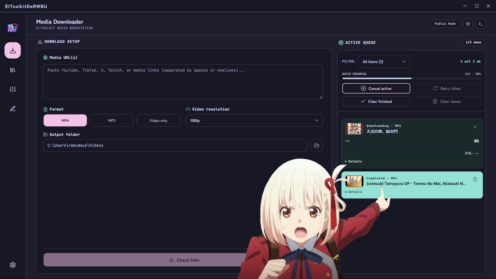
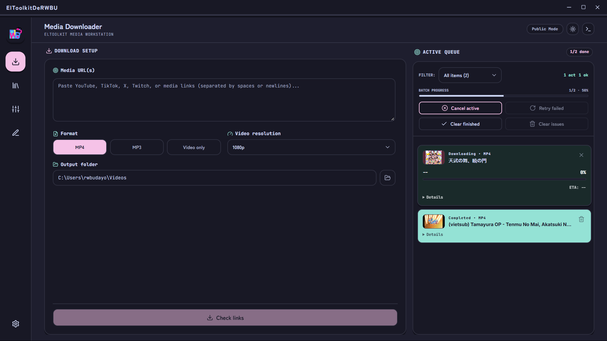
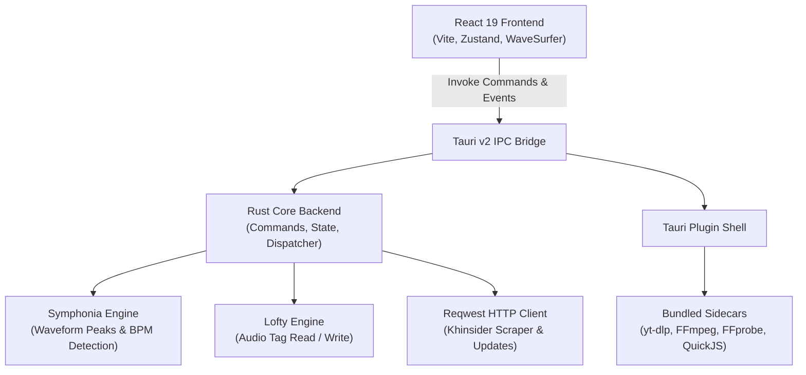

<div align="center">


<h1>ELTOOLKIT DE RWBU</h1>

[](https://github.com/rwbu69/eltoolkitde_rwbu/releases/latest)
[](https://github.com/rwbu69/eltoolkitde_rwbu/releases)
[](LICENSE)
[](https://github.com/rwbu69/eltoolkitde_rwbu/releases/latest)
[](https://github.com/rwbu69/eltoolkitde_rwbu/actions/workflows/ci.yml)
[](https://tauri.app)
[](https://react.dev)
[](https://www.rust-lang.org)

<br />



</div>

<br />

> _"Another terminal window for ffmpeg? Really? Just drop the file here and let me handle it. (_ ^ ω ^)"_

---

<div align="center">

**[Download](#download)** ・
**[User Guide](USER_GUIDE.md)** ・
**[Logic Reference](LOGIC_REFERENCE.md)** ・
**[Report Bug](https://github.com/rwbu69/eltoolkitde_rwbu/issues/new?template=bug_report.yml)** ・
**[Request Feature](https://github.com/rwbu69/eltoolkitde_rwbu/issues/new?template=feature_request.yml)**

</div>

---

## Why This Exists

I got tired of opening three separate terminal windows just to download a video, chop five seconds off an audio track, fix an MP3 whose artist was literally `"Unknown"`, or rename forty files without fat-fingering a regex.

Retyping the same `yt-dlp` and `ffmpeg` flags from memory gets old fast. **ElToolkitDeRWBU** is my workaround: a Catppuccin-tinted, visual-novel-HUD-styled desktop workstation that bundles `yt-dlp`, `FFmpeg`, `FFprobe`, `QuickJS`, and native Rust audio engines behind buttons you can actually click.

<div align="center">
  
  &nbsp;
  
</div>

---

## Download

Precompiled releases live on the [GitHub Releases page](https://github.com/rwbu69/eltoolkitde_rwbu/releases/latest). All external sidecars (`FFmpeg`, `FFprobe`, `yt-dlp`, and `QuickJS`) are bundled straight inside the installer—no Python or system PATH setup needed.

| Platform | Architecture / Target | Package Type | Release File Pattern |
| :--- | :--- | :--- | :--- |
| **Windows** | 64-bit (x86_64) | NSIS Installer | `ElToolkitDeRWBU_*_x64-setup.exe` |
| **Linux** | 64-bit (x86_64) | Standalone AppImage | `ElToolkitDeRWBU_*_amd64.AppImage` |
| **Linux** | Debian / Ubuntu (x86_64) | Debian Package | `ElToolkitDeRWBU_*_amd64.deb` |
| **macOS** | Apple Silicon (M1/M2/M3/M4) | DMG Disk Image | `ElToolkitDeRWBU_*_aarch64.dmg` |
| **macOS** | Intel (x86_64) | DMG Disk Image | `ElToolkitDeRWBU_*_x64.dmg` |

> [!IMPORTANT]
> macOS builds are architecture-specific. Grab `aarch64` for Apple Silicon (M1 or newer) or `x64` for Intel Macs.

<details>
<summary>Running unsigned builds on macOS</summary>

Because releases are currently distributed without Apple Developer notarization, macOS Gatekeeper blocks the first launch by default. To run the app:

1. Download the matching `.dmg`, double-click to open it, and drag `ElToolkitDeRWBU` into your `Applications` folder.
2. In Finder, **Right-click (or Control-click)** `ElToolkitDeRWBU` and select **Open**.
3. In the warning prompt that appears, click **Open**.

If macOS does not show the Open button:

1. Open **System Settings** → **Privacy & Security**.
2. Scroll to the Security section where it mentions *ElToolkitDeRWBU was blocked from use*.
3. Click **Open Anyway**.

If Gatekeeper continues to block the application or its bundled binary sidecars, open Terminal and clear the quarantine attribute:

```bash
xattr -dr com.apple.quarantine "/Applications/ElToolkitDeRWBU.app"
open "/Applications/ElToolkitDeRWBU.app"
```

</details>

<details>
<summary>Running on Linux</summary>

#### AppImage

```bash
chmod +x ElToolkitDeRWBU*.AppImage
./ElToolkitDeRWBU*.AppImage
```

#### Debian / Ubuntu Package

```bash
sudo apt install ./ElToolkitDeRWBU*.deb
```

*Note*: Packages are compiled on Ubuntu 22.04 with standard GNU libc. On minimal installations, ensure desktop dependencies such as WebKitGTK (`libwebkit2gtk-4.1-dev` and `libgtk-3-0`) are installed.
</details>

---

## What It Can Do

Need a full walkthrough of where every button lives and how to use each tool? Read **[USER_GUIDE.md](USER_GUIDE.md)**.

| Tool | Core Capability | Under the Hood |
| :--- | :--- | :--- |
| **Media Downloader** | Download MP4, MP3, and video-only streams with Active Queue thumbnails, embedded cover art, and Resolume-friendly H.264/H.265 handling | `yt-dlp` + `QuickJS` + `FFmpeg` |
| **Game Music Browser** | Search, explore, and batch download game soundtracks with album art *(opt-in via Settings)* | `Reqwest` + `Scraper` (Khinsider) |
| **Audio Studio** | Interactive waveform inspection, playback looping, millisecond nudge trimming, and lossless stream cutting | `wavesurfer.js` + `Symphonia` + `FFmpeg` |
| **FFmpeg Processor** | Batch MP3 extraction, lossless timestamp trimming, and horizontal video mirroring | Bundled `FFmpeg` + `FFprobe` |
| **BPM Tuner** | Native Rust tempo detection, confidence scoring, manual BPM correction, and pitch-preserving tempo changes | `Symphonia` + `FFmpeg` |
| **Metadata Editor** | Pre-fill and edit Title, Artist, Album, and Year across 7 audio formats with one-click restore backups | `Lofty` Rust Engine |
| **Batch File Renamer** | Find & replace, prefix/suffix, and sequential numbering with collision checks and one-click undo | Native Rust `safe_rename` |
| **Workstation HUD** | Catppuccin Mocha & Latte themes, system tray minimization, live System Logs drawer, single-instance lock | `Tauri v2` + `Zustand` + `Tailwind CSS` |

<details>
<summary>Tool Breakdown & Highlights</summary>

### Media Downloader (`yt-dlp` + `QuickJS`)
- **All-Resolution & Resolume-Safe Codec Pipeline**: Picks `360p`–`4K` properly using native resolution sorting. By default (**`H.264 / H.265 (No AV1/VP9 — Fastest)`**), native H.264/H.265 streams finish with zero re-encoding while AV1/VP9 streams (like 1440p/4K) auto-transcode using GPU encoders (`nvenc` / `qsv` / `amf` / `videotoolbox` → CPU fallback), `-pix_fmt:v:0 yuv420p`, `-movflags +faststart`, and live `%` progress.
- **Active Queue Thumbnails & Filters**: Compact 16:9 thumbnails on queue cards, status filters (`All`, `Active`, `Completed`, `Failed`), rate-limit auto-pause/Resume, and cancellable FFmpeg transcodes.
- **Embed-Only Thumbnails**: Cover art is embedded straight into MP4/MP3 outputs (`--embed-thumbnail`, `--convert-thumbnails jpg`) with zero leftover `.jpg`/`.webp` clutter.
- **Atomic In-App `yt-dlp` Updates**: Update `yt-dlp` cleanly from **Settings → Engine binary updates** without blocking the UI.

### Game Music Browser (Khinsider)
- **Disabled by Default**: Hidden until enabled in **Settings → Game music (Khinsider)**—zero network requests when turned off.
- **Batch or Single Track**: Browse categories, search albums, select individual tracks or download entire albums in MP3/FLAC into numbered album subfolders (`01 - Track.mp3`) with polite rate limiting and `vgmtreasurechest.com` origin checks.

### Audio Studio, BPM Tuner, Metadata & Batch Renamer
- **Waveform Trimmer**: Native Rust `symphonia` peak extraction (`< 4 MB` RAM) paired with `wavesurfer.js` draggable regions, `Play Selection`, `Loop`, zoom, `±100ms`/`±1s` nudges, and lossless `-c copy` trimming.
- **Metadata Editor**: Supports `.mp3`, `.flac`, `.m4a`, `.ogg`, `.wav`, `.opus`, and `.aac`, pre-fills existing tags in single-file mode, and creates `.metadata-backup.<ext>` backups so **Restore original** always works.
- **BPM Tuner**: Native Rust onset/autocorrelation BPM detection (`70–150`, `90–180`, `120–200`, or `Any`), manual BPM override, and `20–300` BPM FFmpeg `atempo` export to WAV or MP3.
- **Batch Renamer**: Live diff preview with `Collision`, `Exists`, and `Invalid` guards, case-only Windows rename support, and **Undo last rename**.

</details>

See [CHANGELOG.md](CHANGELOG.md) for the complete version history.

---

## Architecture



Want to know which file handles each menu and feature? Check **[LOGIC_REFERENCE.md](LOGIC_REFERENCE.md)**.

---

## Build from Source

### Prerequisites
- [Node.js](https://nodejs.org) (v24 recommended) and `npm`
- [Rust](https://rustup.rs) (stable) and [Tauri v2 system prerequisites](https://v2.tauri.app/start/prerequisites/)
- C compiler tools (Visual Studio C++ Build Tools on Windows, `build-essential` on Linux, Xcode Command Line Tools on macOS)
- No Python runtime is required.

### Setup & Commands

```bash
git clone https://github.com/rwbu69/eltoolkitde_rwbu.git
cd eltoolkitde_rwbu
npm ci
```

Sidecar binaries (`ffmpeg`, `ffprobe`, `yt-dlp`, and `qjs`) are downloaded automatically by `scripts/setup-sidecars.cjs` whenever you run `npm run dev` or `npm run build`.

```bash
npm run dev        # Run desktop app in development mode
npm run build      # Build desktop release installer
npm run vite:dev   # Preview frontend only in browser
npm test           # Run Vitest unit tests
npm run lint       # Run oxlint
```

---

## A Personal Note

It's not trying to be a full DAW or an enterprise media pipeline. Sometimes a video host changes its player script at 2 AM; sometimes a clip just needs a 100-millisecond nudge before a set.

Also, full disclosure: **this software is made with heavy AI usage and assistance.** I still maintain and update it bit by bit whenever I break something or need a new button for my own workflow, mostly with AI helping cover my skill issues. Use it at your own discretion—and if it saves you ten minutes of terminal gymnastics too, even better. (≧◡≦)

---

## FAQ & Troubleshooting

<details>
<summary>Common questions</summary>

- **Where are my files saved?**
  In the directory set under **Settings → Default output folder** (or whichever folder you picked directly inside Downloader / Audio Studio).
- **Why are there no standalone `.jpg` or `.webp` files next to my downloads?**
  ElToolkitDeRWBU embeds cover art straight into `.mp4` and `.mp3` files (`--embed-thumbnail`, `--convert-thumbnails jpg`) instead of cluttering your folders with loose image files.
- **Why isn't the Game Music (Khinsider) tab showing up?**
  It is disabled by default for privacy and bandwidth etiquette. Turn it on under **Settings → Game music (Khinsider)**.
- **How do I update `yt-dlp` when YouTube changes something?**
  Open **Settings → Engine binary updates** and click **Check for yt-dlp update**.
- **Where are logs when something fails?**
  Click the `>_` terminal button in the top-right HUD (it pulses red and opens automatically on errors).

</details>

---

## Contributing & Security

Bug reports, documentation fixes, and focused PRs are welcome. Please read [CONTRIBUTING.md](CONTRIBUTING.md), [CODE_OF_CONDUCT.md](CODE_OF_CONDUCT.md), and [LOGIC_REFERENCE.md](LOGIC_REFERENCE.md) before opening a pull request.

For security vulnerabilities, report privately according to [SECURITY.md](SECURITY.md) instead of opening a public issue. Never post session cookies, credentials, or personal media links in public issues.

---

## Acknowledgements & Third-Party Software

Standing on the shoulders of open-source giants: [FFmpeg & FFprobe](https://ffmpeg.org), [yt-dlp](https://github.com/yt-dlp/yt-dlp), [QuickJS (`quickjs-ng`)](https://github.com/quickjs-ng/quickjs), [Tauri](https://tauri.app), [Symphonia](https://github.com/pdeljanov/Symphonia), [Lofty](https://github.com/Serial-ATA/lofty-rs), [React](https://react.dev), [Vite](https://vitejs.dev), [Zustand](https://github.com/pmndrs/zustand), [wavesurfer.js](https://wavesurfer.js.org), [Tailwind CSS](https://tailwindcss.com), [Catppuccin](https://github.com/catppuccin/catppuccin), [Vitest](https://vitest.dev), and [oxlint](https://oxc.rs).

Release packages bundle precompiled static binaries of FFmpeg, FFprobe, yt-dlp, and QuickJS (`qjs`). The bundled static FFmpeg and FFprobe builds include GPL-licensed libraries (such as `libx264`) and are distributed under **GPL-3.0-or-later**. Full license texts and source links live in [THIRD_PARTY_NOTICES.md](THIRD_PARTY_NOTICES.md).

## Disclaimer & License

Please only download, convert, or modify media you have the legal right or permission to process, and respect the terms of service and access limits of third-party services including [Khinsider](https://downloads.khinsider.com/).

ElToolkitDeRWBU source code is released under the **MIT License**. Copyright (c) 2026 RWBU. See [LICENSE](LICENSE) for details.

---

<div align="center">

_Happy downloading and mixing. (◕‿◕)_

</div>
