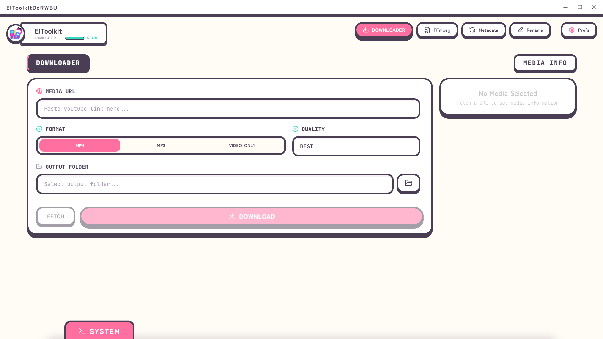

<div align="center">

# ElToolkitDeRWBU

**A friendly desktop toolkit for downloading, converting, tagging, renaming, and analyzing audio.**

ElToolkitDeRWBU brings several excellent open-source tools together in one
comfortable, game-inspired desktop application. My goal is to make common
media and audio workflows feel approachable without requiring a terminal for
every task.



</div>

## Why this exists

I kept reaching for the same command-line tools to download a video, trim a
clip, fix a batch of MP3 tags, or rename a messy folder, and retyping the same
flags every time. ElToolkitDeRWBU is my answer: the tools I actually use,
wrapped in an interface that is quick to use and pleasant to look at.

This project would not be possible without the remarkable work of the
open-source communities behind [FFmpeg](https://ffmpeg.org),
[yt-dlp](https://github.com/yt-dlp/yt-dlp), [Tauri](https://tauri.app), and
many other projects listed below. I am sincerely grateful to the maintainers
and contributors who make these tools available.

## Features

- **Media Downloader (yt-dlp):**
  - Download MP4 video, MP3 audio, or video-only streams.
  - Quality selection ranging from 360p up to 4K with adaptive quality fallback.
  - Configurable audio bitrates (192k, 256k, 320k).
  - Pre-download inspection modal for multi-URL batches and full playlists.
  - Parallel downloads (1–10 concurrent jobs managed via `p-limit`) and download rate throttling (e.g. `5M` or `500K`).
  - Authentication support via direct browser cookie extraction (Chrome, Firefox, Edge, Brave, Safari, Opera) or Netscape `cookies.txt` files.
  - Safe queue management: cancel individual or all tasks and retry failed downloads.
  - Queue filters for active, failed/canceled, and completed items.
  - Quick presets for MP3 320 kbps, MP4 1080p, and 1080p video-only downloads.
  - Manual yt-dlp updates use a temporary download and executable validation
    before replacing the bundled binary.

- **Khinsider Browser and Downloader:**
  - Browse Khinsider categories and soundtrack pages inside the app.
  - Search for games, albums, or artists without opening a separate browser.
  - Open an album to inspect its detected track list.
  - Display album artwork when available, with lazy loading and a fallback.
  - Download individual or selected tracks as MP3 or FLAC.
  - Track batch progress and provide a summary when the batch is complete.
  - Uses conservative request pacing, short-lived caching, and respectful
    retry backoff when loading Khinsider pages.
  - This feature is intended to complement [Khinsider](https://downloads.khinsider.com/)
    and respects the service's availability and access limitations.

- **FFmpeg Tools:**
  - **Audio Extraction:** Batch convert media files to MP3 using `libmp3lame` at user-selected bitrates.
  - **Trimming:** Losslessly trim media files by exact start and end timestamps (`hh:mm:ss`) using stream copy (`-c copy`) without re-encoding.
  - **Mirroring:** Batch horizontal flipping (`-vf hflip`) with H.264 video compression, AAC audio, and real-time progress tracking probed via `ffprobe`.

- **BPM Modifier:**
  - **Tempo Detection:** Uses `librosa` harmonic-percussive source separation (HPSS), onset envelopes, and beat tracking.
  - **Octave & Ambiguity Handling:** Constrain analysis to expected BPM ranges (`70–150`, `90–180`, `120–200`, or `any`) with confidence ratings (`high`, `medium`, `low`) and octave candidate suggestions (0.5x, 1x, 2x).
  - **Manual Correction:** Interactive inline BPM correction input (with `0.01` precision) to fix slight drift or octave mismatches prior to processing.
  - **Pitch-Preserving Tempo Modification:** Applies time-stretching (`librosa.effects.time_stretch`) to match any unified target tempo between 20 and 300 BPM.
  - **Export Options:** Output directly to lossless WAV or convert to compressed MP3 via FFmpeg (`-q:a 2`).

- **Batch Metadata Editor:**
  - Write standard ID3 tags (Title, Artist, Album, Year) to MP3 files.
  - Supports single-file or recursive batch folder tagging with live progress tracking.

- **Batch File Renamer:**
  - Modes for Find and Replace (with case-sensitivity toggle), Prefixes & Suffixes, and Sequential Numbering (custom base name, start index, and zero padding like `Track_001`).
  - Real-time preview with collision and conflict detection before renaming files on disk.
  - One-click undo to restore previous filenames.

- **Quality of Life:**
  - Catppuccin-inspired Light and Midnight Dark themes.
  - Custom game-styled frameless window and titlebar.
  - Optional minimize-to-system-tray behavior with native desktop notifications.
  - Live System Terminal Log view for troubleshooting background operations.
  - Graceful cancellation for every running child process.
  - Authentication selections are kept for the current session only and are
    cleared when the app restarts.
  - Metadata edits create a same-folder backup that can be restored from the
    Metadata Editor.

See [CHANGELOG.md](CHANGELOG.md) for the complete version history.

## Project status and contributing

This is an early release maintained by a small team. Contributions and bug
reports are welcome, but response times may vary. Please read
[CONTRIBUTING.md](CONTRIBUTING.md) before opening a pull request, and use the
issue templates for bug reports and feature requests.

Security issues must be reported privately according to [SECURITY.md](SECURITY.md).
Please do not include cookies, credentials, or personal data in public issues.

## Download

Grab the latest prebuilt release for your operating system from the [Releases page](https://github.com/rwbu69/eltoolkitde_rwbu/releases/latest). All dependencies (FFmpeg, FFprobe, yt-dlp, Node.js, and BPM tools) are bundled with the installer.

| Platform | Format | Recommended Release File |
| :--- | :--- | :--- |
| **Windows (64-bit)** | NSIS Installer | `ElToolkitDeRWBU_*_x64-setup.exe` |
| **Linux (64-bit)** | AppImage | `ElToolkitDeRWBU_*_amd64.AppImage` |
| **Linux (Debian / Ubuntu 64-bit)** | Debian Package | `ElToolkitDeRWBU_*_amd64.deb` |
| **macOS (Apple Silicon)** | Disk Image | `ElToolkitDeRWBU_*_aarch64.dmg` |
| **macOS (Intel)** | Disk Image | `ElToolkitDeRWBU_*_x64.dmg` |

> [!IMPORTANT]
> macOS builds are native and architecture-specific. Be sure to download the build matching your Mac (`aarch64` for Apple Silicon M1/M2/M3/M4, `x64` for Intel).

### Running Unsigned Builds on macOS

Because macOS releases are distributed without Apple Developer notarization, macOS Gatekeeper will block first launch by default. To run the app:

1. Download the matching `.dmg`, open it, and drag `ElToolkitDeRWBU` to your `Applications` folder.
2. In Finder, **Right-click (or Control-click)** the app icon and select **Open**.
3. In the warning dialog that appears, click **Open**.

If macOS still does not present the Open option:
1. Open **System Settings** → **Privacy & Security**.
2. Scroll down to find the security message stating *ElToolkitDeRWBU was blocked from use*.
3. Click **Open Anyway**.

If Gatekeeper persistently refuses to launch the application or its bundled sidecars, open Terminal and remove the quarantine attribute:

```bash
xattr -dr com.apple.quarantine "/Applications/ElToolkitDeRWBU.app"
open "/Applications/ElToolkitDeRWBU.app"
```

### Running on Linux

#### AppImage
```bash
chmod +x ElToolkitDeRWBU*.AppImage
./ElToolkitDeRWBU*.AppImage
```

#### Debian / Ubuntu
```bash
sudo apt install ./ElToolkitDeRWBU*.deb
```

*Note*: Packages are built on Ubuntu 22.04 with standard GNU libc. On minimal distributions, ensure common desktop libraries such as WebKitGTK (`libwebkit2gtk-4.1-dev` / `libgtk-3-0`) and `libsndfile1` are installed.

### Known Packaging Boundaries
- Supported targets are 64-bit Windows, 64-bit Linux (glibc), macOS Intel x64, and macOS Apple Silicon ARM64.
- ARM Linux and universal macOS fat binaries are not currently targeted because all bundled binary sidecars require native compilation for each target architecture.

## Build from Source

### Prerequisites
- [Node.js](https://nodejs.org) (v24 recommended) and `npm`
- [Rust](https://rustup.rs) (stable) and [Tauri v2 system prerequisites](https://v2.tauri.app/start/prerequisites/) for your OS
- [Python 3.11+](https://www.python.org) (only needed if compiling the BPM sidecars locally)

### 1. Clone and Install Dependencies
```bash
git clone https://github.com/rwbu69/eltoolkitde_rwbu.git
cd eltoolkitde_rwbu
npm ci
```

### 2. Sidecar Preparation
- **FFmpeg, FFprobe, Node.js, and yt-dlp**: Handled **automatically**. Tauri hooks (`beforeDevCommand` and `beforeBuildCommand` in `tauri.conf.json`) run `scripts/setup-sidecars.cjs`, which downloads host-compatible binaries into `src-tauri/`.
- **Python BPM Sidecars (`bpm_detector` & `bpm_modifier`)**: For local development, compile the standalone Python executables once using PyInstaller:
  ```bash
  pip install pyinstaller librosa soundfile
  pyinstaller --onefile --distpath src-tauri --name bpm_detector-<TARGET> src-python/bpm_detector.py
  pyinstaller --onefile --distpath src-tauri --name bpm_modifier-<TARGET> src-python/bpm_modifier.py
  ```
  *(Replace `<TARGET>` with your target triple, e.g. `x86_64-pc-windows-msvc`, `x86_64-unknown-linux-gnu`, `x86_64-apple-darwin`, or `aarch64-apple-darwin`).*

### 3. Run and Build Commands
- **Run desktop app (development)**:
  ```bash
  npm run dev
  ```
- **Build desktop installer (production)**:
  ```bash
  npm run build
  ```
- **Run frontend only in browser**:
  ```bash
  npm run vite:dev
  ```
- **Run test suite**:
  ```bash
  npm test
  ```
- **Lint frontend code**:
  ```bash
  npm run lint
  ```

## Tech Stack

- **Desktop Framework:** [Tauri v2](https://tauri.app) (Rust shell, OS integrations, native windowing, sidecar process isolation)
- **Frontend UI:** [React 19](https://react.dev), [TypeScript](https://www.typescriptlang.org), [Vite 8](https://vitejs.dev)
- **State Management:** [Zustand](https://github.com/pmndrs/zustand) with persistent settings storage
- **Styling:** [Tailwind CSS](https://tailwindcss.com) with Catppuccin color tokens
- **Audio Processing:** Python 3.11, [librosa](https://librosa.org), and [soundfile](https://github.com/bastibe/python-soundfile)
- **Bundled Engines:** [FFmpeg](https://ffmpeg.org), [FFprobe](https://ffmpeg.org), [yt-dlp](https://github.com/yt-dlp/yt-dlp), [Node.js](https://nodejs.org)
- **Testing & Quality:** [Vitest](https://vitest.dev) and [oxlint](https://oxc.rs)
- **Continuous Integration:** Native GitHub Actions matrix runners (`windows-latest`, `ubuntu-22.04`, `macos-14`, `macos-15-intel`)

## Acknowledgements

I would like to give my sincere thanks to the people and communities behind
the projects that make this application possible:

- [FFmpeg](https://ffmpeg.org) and [FFprobe](https://ffmpeg.org/) for the
  dependable media processing, conversion, trimming, and inspection foundation.
- [yt-dlp](https://github.com/yt-dlp/yt-dlp) for its powerful and flexible
  media download capabilities.
- [Khinsider](https://downloads.khinsider.com/) for the soundtrack browsing
  experience that inspired the in-app browser and downloader.
- [VGMTreasureChest](https://vgmtreasurechest.com/) for the soundtrack media
  delivery infrastructure used by links surfaced through Khinsider.
- [Tauri](https://tauri.app) for making it possible to build a lightweight
  cross-platform desktop application with native OS integrations.
- [React](https://react.dev), [TypeScript](https://www.typescriptlang.org),
  [Vite](https://vitejs.dev), and [Zustand](https://github.com/pmndrs/zustand)
  for the application foundation.
- [librosa](https://librosa.org) and
  [python-soundfile](https://github.com/bastibe/python-soundfile) for the BPM
  analysis and audio-processing features.
- [Tailwind CSS](https://tailwindcss.com) and
  [Catppuccin](https://github.com/catppuccin/catppuccin) for helping shape the
  application's visual language.
- [Vitest](https://vitest.dev) and [oxlint](https://oxc.rs) for helping keep
  the project reliable during development.
- The visual novel and game HUD communities, whose design language continues
  to inspire the layout and interface.

The project is developed with care and with the help of AI-assisted
development workflows. AI assistance supports the process, while the
architecture, product decisions, and implementation are reviewed as part of
the project itself.

## Third-Party Software

Release packages bundle FFmpeg, FFprobe, yt-dlp, Node.js runtime binaries, and
Python audio libraries, each distributed under its respective open-source
license. The bundled static FFmpeg and FFprobe builds are licensed under the
**GNU General Public License v3.0 or later (GPL-3.0-or-later)**.

Please take a moment to review and support the upstream projects when you find
them useful. Their documentation, issue trackers, and contributor communities
are valuable resources for everyone who builds on top of them.

For full license texts, upstream links, and instructions on obtaining source code for bundled software, please review [THIRD_PARTY_NOTICES.md](THIRD_PARTY_NOTICES.md).

## Disclaimer

Please only download, convert, or modify media that you have the legal right
or permission to process. Please respect the intellectual property rights,
terms of service, robots policies, and access limits of third-party websites
and services, including [Khinsider](https://downloads.khinsider.com/).
ElToolkitDeRWBU is provided as a tool and does not grant permission to access
or redistribute content.

## License

ElToolkitDeRWBU source code is released under the **MIT License**. Copyright (c) 2026 RWBU. See [LICENSE](LICENSE) for details.
